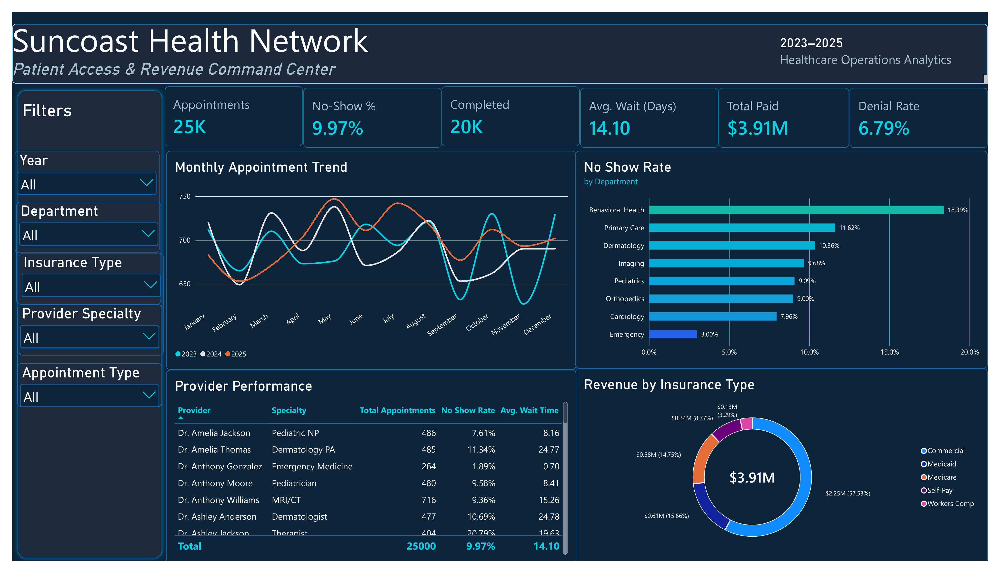
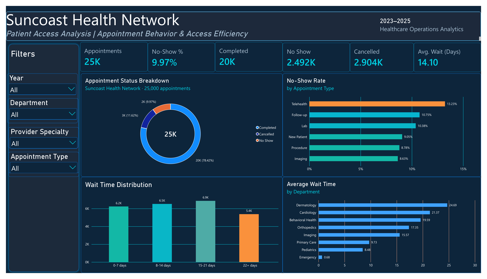
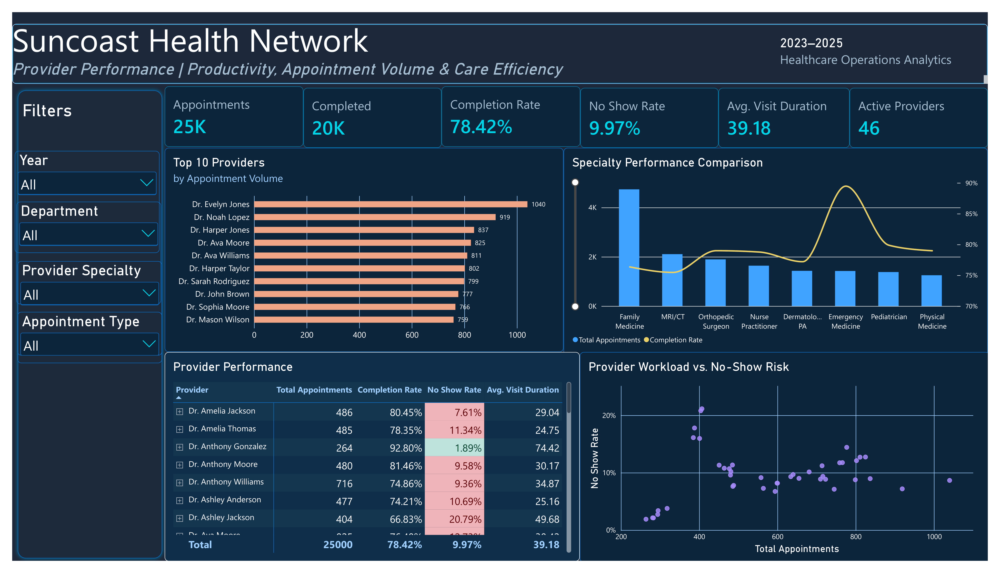
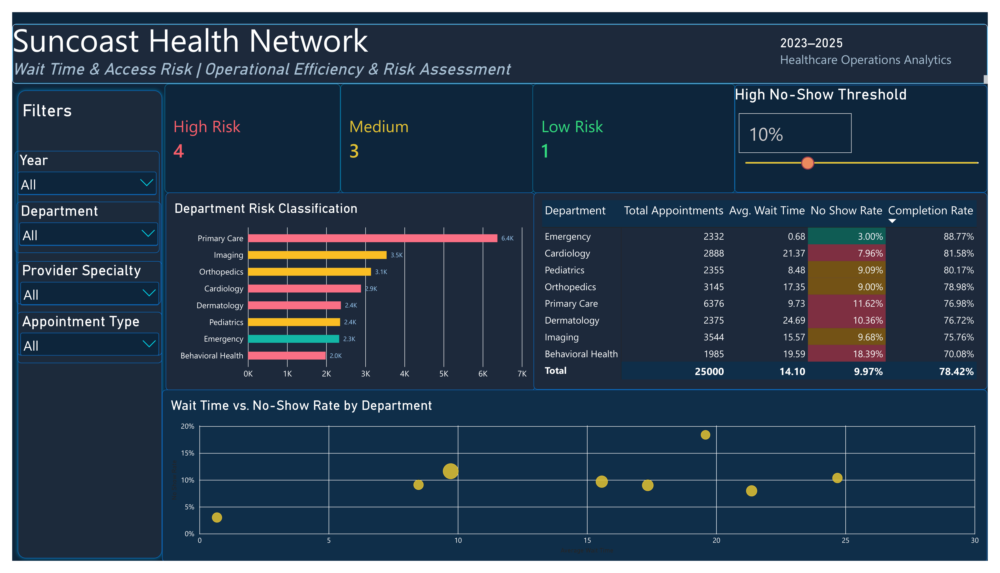
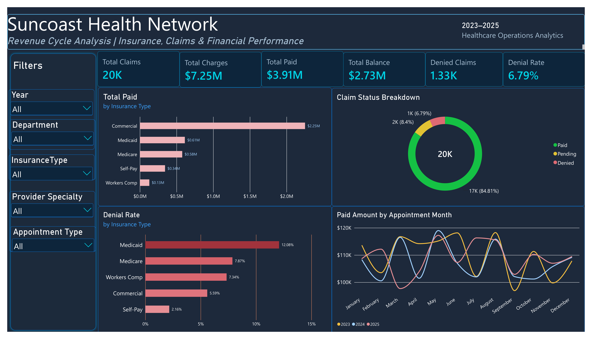

# Suncoast Health Network | Healthcare Operations Analytics

**End-to-end data analytics portfolio project** | Microsoft SQL Server · SSMS · Excel · Power Query · Power Pivot · DAX · Power BI

> **Synthetic-data disclaimer:** Suncoast Health Network is fictional. The data and findings are simulated for educational and portfolio purposes and do not describe a real healthcare system.

## Project overview

This project develops a reporting workflow to examine appointment activity, patient access, provider productivity, wait times, and billing outcomes. SQL Server stores and validates the relational data, Excel/Power Pivot supports analytical exploration, and Power BI presents five interactive reporting pages.

## Business questions

- How many appointments are completed, cancelled, or missed?
- Which departments and appointment types show higher no-show rates?
- How do wait times vary across departments?
- How do provider appointment workloads compare with completion and no-show rates?
- How do billing charges, payments, balances, claims, and denials vary by insurance?

## Data model and source tables

| Table | Rows | Role |
| --- | ---: | --- |
| `DimPatient` | 2,000 | Patient characteristics |
| `DimProvider` | 46 | Providers and specialties |
| `DimDepartment` | 8 | Departments |
| `DimInsurance` | 5 | Insurance types |
| `DimDate` | 1,096 | Date attributes |
| `FactAppointments` | 25,000 | Appointment-level activity |
| `FactBilling` | 19,604 | Billing and claims |

The supplied SQL schema defines primary keys on the ID fields and foreign-key relationships from appointments to their dimensions and from billing to appointments, patients, and insurance.

## Workflow

1. **Relational schema:** Defined dimensional and fact tables in SQL Server.
2. **CSV imports:** Used SQL Server `BULK INSERT` with header skipping (`FIRSTROW = 2`) to populate the tables.
3. **Validation:** Checked missing keys using `LEFT JOIN`, duplicate identifiers, and other quality checks.
4. **SQL analysis:** Queried appointment status, no-show patterns, departmental performance, and financial outcomes.
5. **Excel analysis:** Used Power Query, Power Pivot, and PivotTables for exploration and modeling.
6. **Power BI modeling:** Built measures, calculated columns, relationships, slicers, and interactive reports.
7. **Interactive risk analysis:** Applied a user-selectable no-show threshold alongside wait-time thresholds to categorize departments.


## Technical Documentation

- [End-to-End Technical Workflow](docs/TECHNICAL_WORKFLOW.md)
- [SQL Data Dictionary](docs/DATA_DICTIONARY.md)


## Power BI Dashboard Walkthrough

The final Power BI report consists of five interactive dashboards designed to analyze patient access, appointment efficiency, provider productivity, departmental risk, and revenue cycle performance.

The report uses simulated healthcare data from 2023–2025. All findings represent hypothetical operational insights rather than real patient or healthcare organization outcomes.

---

### 1. Executive Overview



**Dashboard Purpose**

The Executive Overview provides a centralized summary of healthcare operations and financial performance, allowing stakeholders to monitor key performance indicators and identify areas requiring further investigation.

**Key Performance Indicators**
- Total Appointments: 25,000
- Completed Appointments: 19,604
- No-Show Rate: 9.97%
- Average Wait Time: 14.10 days
- Total Paid: Approximately $3.91 million
- Claim Denial Rate: 6.79%

**Key Insights**

- Behavioral Health records the highest departmental no-show rate at 18.39%, compared with 3.00% for Emergency.
- Commercial insurance accounts for approximately $2.25 million in paid amounts, representing the largest share among insurance categories.
- Monthly appointment volume can be compared across 2023, 2024, and 2025 to identify seasonal patterns.

**Technical Implementation**

Built using DAX measures, year-based trend analysis, interactive slicers, department-level comparisons, insurance-based revenue breakdowns, and provider performance summaries.

**Business Value**

Offers leadership a consolidated view of patient access and financial outcomes, supporting the prioritization of operational improvement opportunities.

---

### 2. Patient Access Analysis



**Dashboard Purpose**

This page examines appointment outcomes, no-show behavior, cancellation patterns, and appointment waiting times to identify potential access and scheduling challenges.

**Key Performance Indicators**
- Total Appointments: 25,000
- Completed: 19,604 (78.42%)
- Cancelled: 2,904 (11.62%)
- No-Shows: 2,492 (9.97%)
- Average Wait Time: 14.10 days

**Key Insights**

- Telehealth appointments show the highest no-show rate among appointment types at 13.23%.
- Imaging appointments have a lower no-show rate of 8.63%.
- Dermatology has the longest departmental average waiting time at 24.69 days.
- Emergency has the shortest average waiting time at 0.68 days.
- The wait-time distribution highlights how appointment volumes vary across four waiting-period categories.

**Technical Implementation**

Appointment status classification, DAX-based completion and no-show calculations, wait-time banding, department comparisons, and interactive filter contexts.

**Business Value**

Helps identify appointment categories and departments that may benefit from further scheduling analysis, patient reminder strategies, or capacity planning.

---

### 3. Provider Performance



**Dashboard Purpose**

This dashboard evaluates provider appointment volume, completion rates, no-show patterns, and visit duration to support workload and productivity analysis.

**Key Performance Indicators**
- Total Appointments: 25,000
- Completed Appointments: 19,604
- Completion Rate: 78.42%
- No-Show Rate: 9.97%
- Average Completed Visit Duration: 39.18 minutes
- Active Providers: 46

**Key Insights**

- Dr. Evelyn Jones records the highest appointment volume shown in the Top 10 Providers chart, with 1,040 appointments.
- The provider performance matrix reveals differences in completion rates, no-show rates, and average visit duration.
- The workload-versus-no-show scatter chart helps visualize variation in no-show rates across providers with different appointment volumes.
- Specialty-level comparisons reveal differences in appointment demand and completion rates.

**Technical Implementation**

Top N filtering, DAX performance measures, conditional formatting, provider-level matrix analysis, combination charts with a secondary axis, and scatter plots.

**Business Value**

Supports the identification of provider workload patterns and potential areas for operational review without assuming that appointment volume alone measures quality of care.

---

### 4. Wait Time & Access Risk Lab



**Dashboard Purpose**

This interactive analytical page allows users to explore department-level access risks through a configurable no-show threshold and supporting wait-time indicators.

**Key Features**

- Dynamic High No-Show Threshold parameter
- High, Medium, and Low Risk department counts
- Department Risk Classification chart
- Department performance matrix
- Wait Time vs. No-Show Rate scatter plot

**Key Insights**

- At the 10% selected high no-show threshold shown in the final dashboard, four departments are classified as High Risk, three as Medium Risk, and one as Low Risk.
- Behavioral Health combines a high no-show rate of 18.39% with an average wait time of 19.59 days.
- Dermatology has an average wait time of 24.69 days, highlighting that waiting time is an important consideration alongside no-show rates.
- Department risk classifications are based on custom analytical thresholds rather than a validated clinical risk scoring system.

**Technical Implementation**

Power BI What-if parameters, SELECTEDVALUE, dynamic DAX risk classification measures, conditional formatting, interactive slicers, and department-level scatter visualization.

**Business Value**

Provides a flexible framework for comparing operational risk signals and exploring how changes to analytical thresholds affect department classifications.

---

### 5. Revenue Cycle Analysis



**Dashboard Purpose**

The Revenue Cycle Analysis dashboard examines claims, charges, paid amounts, balances, insurance performance, and claim denial patterns.

**Key Performance Indicators**
- Total Claims: 19,604
- Total Charges: Approximately $7.25 million
- Total Paid: Approximately $3.91 million
- Total Balance: Approximately $2.73 million
- Denied Claims: Approximately 1,330
- Denial Rate: 6.79%

**Key Insights**

- Commercial insurance represents the largest share of paid amounts, approximately $2.25 million.
- Medicaid has the highest denial rate among the displayed insurance categories at 12.08%.
- Self-Pay has the lowest displayed denial rate at 2.16%.
- Paid amounts can be compared by appointment month and year to explore financial outcomes associated with appointments.

**Technical Implementation**

DAX aggregation and ratio measures, insurance-level analysis, claim status breakdowns, time-series comparison, and relationship-aware calculations using USERELATIONSHIP.

The payment trend is grouped by appointment month rather than the actual payment transaction month. This distinction is important when interpreting financial performance over time.

**Business Value**

Supports the identification of insurance categories with relatively higher denial rates and provides a consolidated view of billing-related performance.

---

## Analytical Limitations

- The dataset is simulated and does not contain real patient outcomes.
- Associations observed in the dashboards do not establish causation.
- Risk classification thresholds are illustrative and should not be interpreted as clinical standards.
- Revenue analysis based on appointment dates differs from cash-flow analysis based on payment dates.
- Recommendations are intended to demonstrate an analytical decision-support workflow.

## Selected overall KPIs

| Metric | Result |
| --- | ---: |
| Total appointments | 25,000 |
| Completed appointments | 19,604 |
| No-show appointments | 2,492 |
| No-show rate | 9.97% |
| Average wait time | 14.10 days |
| Total paid | Approximately $3.91 million |
| Total claims | 19,604 |
| Claim denial rate | 6.79% |

Numbers represent the all-period, unfiltered simulated dataset and may be displayed with rounding in report visuals.

## Reporting conventions and model caveats

- **Appointment-year attribution:** Measures using `USERELATIONSHIP` associate billing amounts with the *appointment date*. The report's “Paid Amount by Appointment Month” should therefore not be described as a cash-receipt / payment-date trend.
- **Relationship ambiguity:** The Power BI model uses an inactive appointment–billing relationship for some calculations; date/department effects on financial measures must be explicitly tested.
- **Risk scoring:** The High/Medium/Low department classification is a **custom operational heuristic**, not a validated clinical risk score.
- **Provider identity:** Use `ProviderID` (or a unique provider display label) in comparisons where duplicate provider names could cause accidental grouping.

## Repository contents

```text
suncoast-health-analytics/
├── README.md
├── sql/
│   ├── 01_Create_Database_and_Tables.sql
│   ├── 02_Bulk_Insert_Data.sql
│   ├── 03_Data_Validation.sql
│   └── 04_Business_Analysis.sql
├── excel/
│   └── Suncoast_Health_Analytics_PowerPivot_Report.xlsx
├── powerbi/
│   └── Suncoast_Health_Network_Analytics_Final.pbix
├── screenshots/
│   ├── 01_executive_overview.png
│   ├── 02_patient_access.png
│   ├── 03_provider_performance.png
│   ├── 04_access_risk_lab.png
│   └── 05_revenue_cycle.png
└── docs/
    ├── data_dictionary.md
    ├── methodology.md
    └── dax_measures.md
```

#### Data Sources & Reproducibility

This project uses simulated healthcare operational data covering 2023–2025. It includes SQL Server scripts, an Excel Power Pivot workbook, and a five-page Power BI report.

The original source CSV files are not currently included in this repository. SQL import scripts reference a local development directory and require path adjustments before execution.

The repository provides the project's analytical workflow and supporting documentation. Full end-to-end reproduction requires the original input datasets and validation of the documented model configuration.
