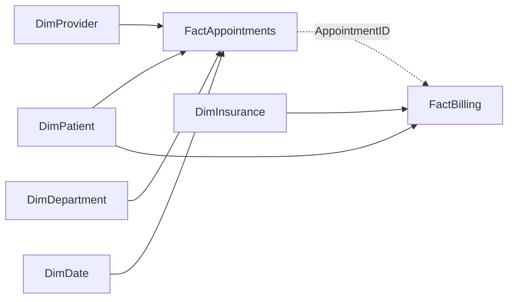

# Data Model & Relationships

**Suncoast Health Network | Synthetic healthcare analytics, 2023–2025**

## 1. SQL schema: verified declared foreign keys

The relationships below are read directly from `01_Create_Database_and_Tables.sql`. They establish the *SQL Server source schema*, not necessarily the active/inactive and cross-filter settings of the Power BI semantic model.

| Child (foreign key) | Parent (primary key) | Source script constraint |
|---|---|---|
| `FactAppointments[PatientID]` | `DimPatient[PatientID]` | `FK_Appointments_Patient` |
| `FactAppointments[ProviderID]` | `DimProvider[ProviderID]` | `FK_Appointments_Provider` |
| `FactAppointments[DepartmentID]` | `DimDepartment[DepartmentID]` | `FK_Appointments_Department` |
| `FactAppointments[DateID]` | `DimDate[DateID]` | `FK_Appointments_Date` |
| `FactBilling[AppointmentID]` | `FactAppointments[AppointmentID]` | `FK_Billing_Appointment` |
| `FactBilling[PatientID]` | `DimPatient[PatientID]` | `FK_Billing_Patient` |
| `FactBilling[InsuranceID]` | `DimInsurance[InsuranceID]` | `FK_Billing_Insurance` |

## 2. Conceptual model



Dashed line: `AppointmentID` relationship was **inactive in the Power BI model during the dashboard build**, although it is a valid foreign key in the SQL database. An inactive Power BI relationship does **not** mean the SQL Server foreign key is absent or disabled.

## 3. Grains

- **Patient dimension:** one row per `PatientID`.
- **Provider dimension:** one row per `ProviderID`.
- **Department dimension:** one row per `DepartmentID`.
- **Insurance dimension:** one row per `InsuranceID`.
- **Date dimension:** one row per `DateID`.
- **Appointments fact:** one row per `AppointmentID`.
- **Billing fact:** one row per `BillingID` (a billing record associated with an appointment).

The final dashboard displays 25,000 appointments and 19,604 billing records. Do not assume every appointment has a billing record, or that there can never be more than one billing record per appointment, without examining uniqueness constraints and observed source data. The supplied SQL schema declares `BillingID` unique, but **does not** declare `FactBilling[AppointmentID]` unique.

## 4. Relationship configuration in Power BI

The report-building workflow established active appointment filters from Date, Department, Patient and Provider dimensions, together with an inactive billing-to-appointment relationship. Billing was also related to Patient and Insurance; however, the final cross-filter directions, relationship cardinalities, and complete active/inactive relationship inventory have **not been independently extracted** from the uploaded `.pbix` binary DataModel.

### Filter-path issue and solution

1. Selecting **Year = 2024** changed appointment KPIs but originally did not change the unmodified `Total Paid` card (approximately $3.91M).
2. A `Total Paid by Appointment Year` measure using `USERELATIONSHIP(FactBilling[AppointmentID], FactAppointments[AppointmentID])` was created and confirmed to respond to the year slicer.
3. Equivalent appointment-year-aware billing measures were built for charges, claims, balances and denied claims, with denial rate recalculated using the resulting filtered counts.
4. The resulting financial interpretation is **paid/charged amounts associated with appointments occurring in the selected period**, rather than payments received in that period.

```dax
Total Paid by Appointment Year =
CALCULATE(
    [Total Paid],
    USERELATIONSHIP(FactBilling[AppointmentID], FactAppointments[AppointmentID])
)
```

**Caution:** Do not activate both alternative model paths indiscriminately. Multiple active filtering paths can introduce ambiguity. Validate the actual filter directions and behavior in **Model view → Manage relationships**.

## 5. Key distinctions for readers

| Concept | Meaning |
|---|---|
| `DimDate[FullDate]` / appointment date | When the appointment occurs |
| `FactBilling[PaymentDate]` | When a payment transaction is recorded |
| `Total Paid by Appointment Year` | Paid amount associated with appointments occurring in the selected year |
| Insurance Type slicer | Categorizes billing records; does not automatically guarantee meaningful filtering of all appointment KPIs |
| No-show threshold | An adjustable, illustrative business rule, not a clinical scoring standard |

## 6. Reproducibility and verification

- The SQL table-creation script as submitted starts with `USE SuncoastHealthAnalytics` (without `CREATE DATABASE`) and includes a trailing comma in the `DimPatient` definition. Correct before executing against a clean SQL Server environment.
- Bulk import refers to external CSVs under `C:\SuncoastHealthDatasets\`; the input files need to be provided separately for complete reproduction.
- Verify actual Power BI relationship `Active`, `Cardinality`, and `Cross filter direction` settings directly in Model view and export a model diagram/screenshot for this documentation.
- Validate row counts, key uniqueness, and billing-date interpretations with fresh source-query results.
